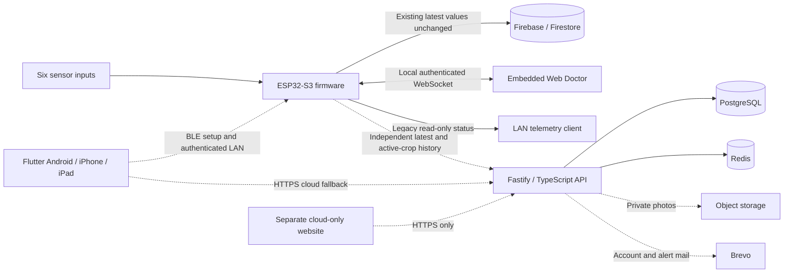
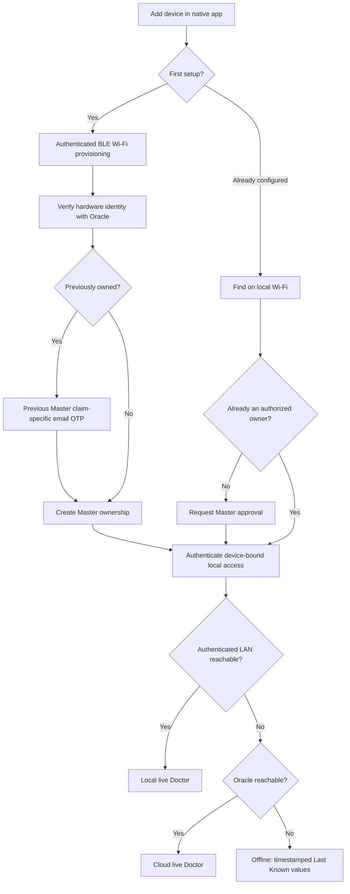

[](https://github.com/Vaibhavsh0120/HyGrow_IoT/actions/workflows/verify.yml)

HyGrow combines ESP32-S3 hydroponic sensors with local monitoring and an evolving
cloud platform. Development happens in small, tested versions on `main`.
The repository remains **HyGrow_IoT**. Sibling projects are independent and untouched.

## What you can run

- **Firmware:** six sensor inputs, persistent configuration/calibration, embedded
  Web Doctor, WebSocket commands and UDP discovery on port **39400**.
- **Firebase:** the existing latest-sensor upload path remains unchanged.
- **Developer tools:** Windows PowerShell 5.1/7 manager, manifest-driven age
  encryption/decryption, regression checks and isolated local services.
- **Backend foundation:** Fastify 5 + TypeScript, PostgreSQL migrations, Redis
  coordination/rate limiting, liveness and dependency readiness endpoints.
- **Background work:** BullMQ worker with durable PostgreSQL job records,
  bounded retries, duplicate protection and an OTP-expiration maintenance job.
  Email/photo/archive jobs will be added with their corresponding features.
- **Diagnostics:** server-generated request IDs, JSON response/error logs with
  route/status/duration/source version, and safe local diagnostic reports.
- **Native entry:** Android/iOS project in `app/`, canonical launcher branding,
  light/charcoal native splash and responsive Welcome/Role Selection. The Farmer
  entry opens the authentication form; account endpoints are the next milestone.

Native account integration, secure ownership/BLE onboarding, Oracle Doctor,
Plant Tracker and cloud website are **V1 work in progress**. Existing LAN `/status`
is a legacy unauthenticated endpoint; secure account-bound LAN access is not yet
implemented. The embedded Doctor stays available during migration.
AI is planned for **V2**, seller tools for **V3**, and buyer commerce for **V4**.
No physical pump automation is currently implemented.

## Versioned delivery plan

Finish and check one screen or feature at a time, outside to inside. Patch
versions carry bounded finished items and repairs within each milestone.

| Version | Deliverable and acceptance boundary |
|---|---|
| 0.3.x | Native identity/branding, launcher, safe splash and Welcome/Role Selection; real emulator light/dark and responsive checks |
| 0.4.x | Farmer signup/OTP, login/secure sessions, recovery/Google, then account and global settings; API/database/email integration tests |
| 0.5.x | Devices and secure BLE/LAN onboarding; hardware proof, claims and approved access, no QR or manual IP entry |
| 0.6.x | Doctor Dashboard/Calibration/Terminal/Settings with local/cloud/offline behavior; owner management, transfers and protected reset/reclaim |
| 0.7.x | Latest/history separation, five-minute defaults, persistent 72-hour backlog, thresholds and alerts; unchanged Firebase and no water-level anomaly alerts |
| 0.8.x | Collaborative Plant Tracker, photos, completion/verified archive, corrections/reopen, reminders and 30-day trash/privacy |
| 0.9.x | Separate cloud-only website/desktop introduction, live deployment, backup/restore and security hardening |
| 1.0.0 | V1 acceptance release after end-to-end gates pass; disclose remaining physical-device evidence explicitly |
| 2 / 3 / 4 | Actual AI tools, Seller Market, then Buyer Market, with truthful availability gates |

APK and unsigned device-release IPA pipelines enter during the native milestones
and are verified throughout; GHCR already publishes source-linked images after
quality gates. A written workflow or UI is not evidence of a working integration.
See tags, commit history and Actions for delivered versions rather than treating
this plan as a completion report.

## Architecture

Solid connections below exist in code. Dashed connections are the planned V1
integration, not a claim of deployed or hardware-tested functionality.



The local API/DB/Redis foundation can run with Compose. The planned Oracle host is
`https://hygrow-india.duckdns.org`; a production deployment is not yet verified.
The cloud website will have no BLE, UDP or direct private-LAN device controls.

## Planned device setup and connection flow



## Start developing

```powershell
.\Dev.ps1 -Help
.\Dev.ps1 -Action Doctor
.\Dev.ps1 -Action Setup -SkipSecrets -SkipContainers -NonInteractive
.\Dev.ps1 -Action StartLocal -NonInteractive
.\Dev.ps1 -Action Status
.\Dev.ps1 -Action Diagnostics -NonInteractive
.\Dev.ps1 -Action Test -NonInteractive
.\Dev.ps1 -Action StopLocal
```

Install Git, Python 3.12+, Node.js 24 LTS, Docker Desktop, age/age-keygen and a
C++17 host compiler. Flutter and the Android SDK are needed for mobile builds;
iOS device builds require macOS. PlatformIO 6.1.18 builds `esp32-s3-n16r8`.
The manager also detects PlatformIO's standard Windows IDE installation.

`Setup` preserves existing local environment values and generates missing local
database/Redis passwords. Omit `-SkipSecrets` to decrypt configured encrypted
files with a hidden local identity prompt. CI/noninteractive decryption fails
instead of waiting for a private key. Local migrations always use the isolated
Compose database. Local services use `http://localhost:8088`; PostgreSQL binds
only to `127.0.0.1:5548`, and Redis is private to the container network.
Stopping services retains development volumes. Tests use separate disposable
PostgreSQL/Redis instances and never the development or production database.

`BuildFirmware`, `Encrypt`, `Decrypt`, `CI`, `Health` and `Clean` are available.
Mobile/live frontend actions check prerequisites and API readiness; unavailable
targets fail clearly until their implementation is delivered.

## Repository

| Path | Responsibility |
|---|---|
| [`firmware/`](firmware/) | PlatformIO/Arduino source, sensors, Web Doctor and host regression suite |
| [`services/api/`](services/api/) | Modular TypeScript backend and database migrations |
| [`app/`](app/) | Flutter Android/iPhone/iPad client; identifier `dev.vaibhavsh0120.hygrow` |
| [`infra/`](infra/) | Isolated development and disposable test services |
| [`Dev.ps1`](Dev.ps1), [`tools/`](tools/) | Windows manager and secret handling |
| [`config/secrets.manifest.json`](config/secrets.manifest.json) | Public recipient and exact secret-file mapping |

See the [firmware guide](firmware/README.md) for wiring, flashing and local
diagnostics. `VERSION` tracks ecosystem development milestones; firmware has a
separate version. Build/check evidence is available in
[GitHub Actions](https://github.com/Vaibhavsh0120/HyGrow_IoT/actions).

## Secrets and delivery

Plaintext secrets, private identities, keys and temporary outputs stay ignored.
`Encrypt` uses the manifest's existing public age recipient. `Decrypt` reads a
private identity through a hidden terminal prompt and supplies it to age via
stdin. Existing plaintext requires `-ReplaceSecrets`; restricted ignored backups
are retained. All files are authenticated before replacement begins.

Quality checks and a production container build/publish run on `main`. The source-linked
image is `ghcr.io/vaibhavsh0120/hygrow_iot-api:sha-<full-commit-sha>`;
the workflow summary records its immutable digest. This is separate from a live deployment.

Native delivery runs on Linux for APKs and macOS for an **unsigned ARM64 device
release IPA**. Android signing uses a persistent project certificate, whose public
fingerprint is in `config/android-signing.json`. Its keystore and properties are
manifest-mapped age ciphertexts; plaintext stays ignored and CI uses encrypted
GitHub secrets. Release builds fail if signing configuration is missing.

The workflow verifies package identity, version and signing state, records the
full source SHA, and publishes versioned development releases only after the
quality jobs pass. APKs are split by ABI. The IPA requires signing/sideloading;
an iOS build is not evidence of runtime behavior on an iPhone/iPad. Download the
artifacts, build metadata and `SHA256SUMS` from
[GitHub Releases](https://github.com/Vaibhavsh0120/HyGrow_IoT/releases).

Android APK, **unsigned iOS device release IPA**, and Coolify deployment are
delivery goals still being implemented. An unsigned IPA
requires a compatible later signing process to install on a stock iOS device.
No App Store signing account is required to generate the requested artifact.
Features are only reported as verified after relevant checks; local simulation,
CI builds, deployed services and physical-device validation are distinct.

For a bug report, run `Dev.ps1 -Action Diagnostics`, include the app/API version
and request ID, then check the matching JSON log in Docker/Coolify. Reports are
saved under ignored `.dev/` and contain no secret-file values. `health/live`
checks the process, `health/ready` checks PostgreSQL/Redis, and `health/worker`
checks the background dispatch heartbeat. Readiness failure is not a fake success.
